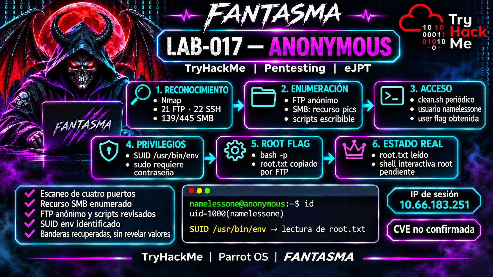

# FANTASMA | LAB-017 — ANONYMOUS

**Plataforma:** TryHackMe  
**Máquina:** Anonymous  
**IP de esta sesión:** 10.66.183.251  
**Dificultad:** Fácil  
**Sistema:** Linux (Ubuntu/Samba)  
**Estado:** User flag y root.txt recuperados mediante archivos; shell interactiva root pendiente  
**CVE:** No confirmada

## Descripción de la portada

Infografía panorámica con el avatar FANTASMA —calavera encapuchada, cuernos, ojos rojos, alas, luna roja y portátil— sobre fondo oscuro con paneles neón cian y magenta. La ruta se cuenta en seis etapas: reconocimiento con Nmap y los cuatro puertos; enumeración de FTP anónimo y SMB/pics; ejecución periódica de clean.sh como namelessone; identificación del SUID /usr/bin/env; lectura de root.txt mediante bash -p; y estado real del acceso. El terminal representa uid 1000 namelessone y la lectura de root.txt, sin afirmar que se obtuvo una shell interactiva root. La portada también muestra IP de sesión y que no se confirmó una CVE. No incluye valores de banderas.

## Resumen del laboratorio

La enumeración detectó cuatro puertos abiertos. FTP permitió acceso anónimo y escritura en /scripts; SMB expuso el recurso pics. El script clean.sh se ejecutaba periódicamente como namelessone. La escalada local aprovechó el SUID de /usr/bin/env para ejecutar bash con privilegios y copiar root.txt a un archivo descargable por FTP. Se recuperaron los valores de ambas banderas. No se obtuvo una sesión interactiva como root.

## Puertos y servicios

| Puerto | Servicio | Identificación observada |
|---|---|---|
| 21/tcp | FTP | vsftpd 3.0.3; acceso anónimo |
| 22/tcp | SSH | OpenSSH 7.6p1 Ubuntu 4ubuntu0.3 |
| 139/tcp | SMB | Samba smbd 3.X–4.X |
| 445/tcp | SMB | Samba 4.7.6-Ubuntu |

## Cadena observada

1. Escaneo Nmap de los 100 puertos TCP más comunes.
2. Listado de recursos SMB; se encontró pics.
3. Enumeración FTP anónima; /scripts resultó escribible.
4. Descarga y análisis de clean.sh, removed_files.log y to_do.txt.
5. Ejecución periódica de clean.sh como namelessone; recuperación de user.txt.
6. Enumeración de permisos SUID; /usr/bin/env permitió ejecutar bash en modo privilegiado y copiar root.txt a una ruta legible por FTP.

## Hallazgos principales

- El acceso anónimo FTP permitía leer y escribir en un directorio del servidor.
- El recurso SMB pics permitía leer dos imágenes.
- clean.sh era modificable desde FTP y se ejecutaba periódicamente.
- La cuenta namelessone pertenecía, entre otros, al grupo lxd; sudo requería contraseña.
- /usr/bin/env tenía SUID. Se usó para ejecutar una orden con privilegios y copiar root.txt.
- Las imágenes no mostraron datos ocultos con steghide al probar una frase vacía; esa vía no fue necesaria para el resultado.

## Evidencias y documentos

- [Informe técnico](01-Informes/INFORME-TECNICO.md)
- [Reconocimiento](02-Reconocimiento/RECONOCIMIENTO.md)
- [Explotación y escalada](03-Explotacion/EXPLOTACION-Y-ESCALADA.md)
- [Descripción de portada](04-Imagenes/README.md)
- [Evidencias públicas](05-Evidencias/publico/README.md)
- [Comandos ejecutados](06-Comandos/COMANDOS.md)
- [Sala TryHackMe](https://tryhackme.com/room/anonymous)

Los valores de las banderas y los archivos privados quedan excluidos del repositorio.
